= Deploying to OpenShift

OpenShift 4 is RedHat's Platform as a Service (PaaS) offering. The system wraps around Kubernetes, and so some of the commands and terminology used refers to the underlying infrastructure. The system consists of deploying applications from images where we can easily recreate and scale up and down services. A service can consist of many different 'pods', which are instances of our application to permit distribution of load. For more information see link:https://kubernetes.io/docs/concepts/overview/what-is-kubernetes/[What is Kubernetes?]. For your coursework, you will have a single service running which will contain your API.

In this module your application is deployed as an *OpenShift Serverless* service (built on link:https://knative.dev/docs/serving/[Knative Serving]). OpenShift uses Source-to-Image (S2I) to build your Quarkus application directly from your GitHub repository into an image, and then runs that image as a Knative Service (shown as *KSVC* in the web console). A serverless service automatically scales down to zero pods when it is not being used, and starts a new pod again when it next receives a request.

Make sure that you fully complete the instructions listed here, up to the point where you must email Adam Booth (adam.booth@newcastle.ac.uk) with your Route information!

// NOTE: Please check the limitations of the *Starter* accounts https://www.openshift.com/pricing/index.html[here]. In particular; "Your project resources sleep after 30 minutes of inactivity, and must sleep 18 hours in a 72 hour period".

Once you have completed the instructions here you should expect your OpenShift resources to be similar to the following image.

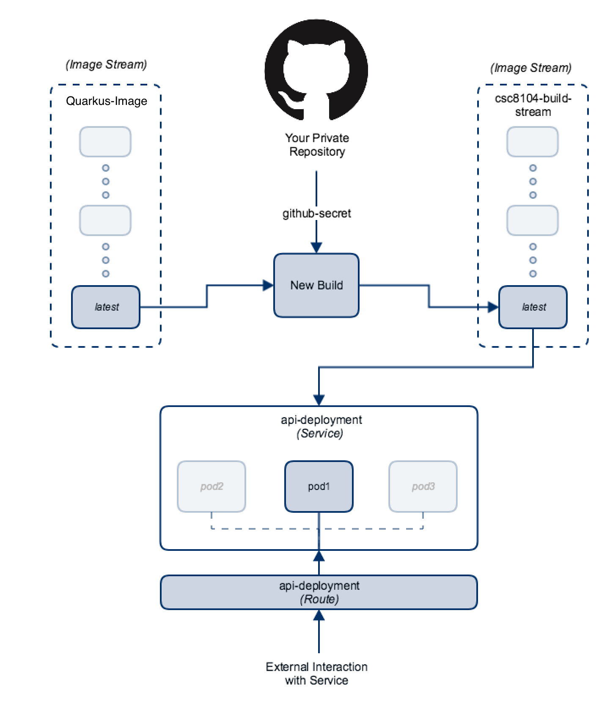

NOTE: The names shown in the image above (and in the screenshots throughout this guide) will differ from yours. OpenShift names your build, image stream, service and route after your GitHub repository.

== Initial Setup

=== Environment Setup

link:https://www.youtube.com/watch?v=2SkR8hDCpvA&t=24m09s[Tutorial Video - 24m09s]

At this stage you should have the accounts setup and the required applications installed to deploy your application to OpenShift. If you are not currently at this stage please refer to the link:./tutorial.asciidoc[tutorial] document.

Once your OpenShift account has been successfully provisioned (as mentioned above), you will have the option to access the web console. To do this, log in to the link:https://sandbox.redhat.com[Red Hat Developer Sandbox] and press the 'Try it' button on the *OpenShift* card.

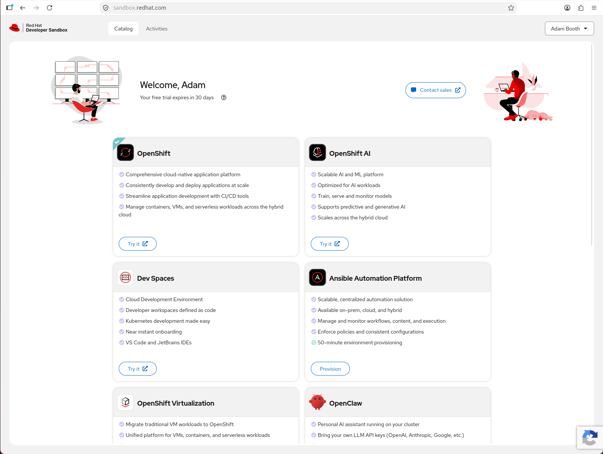

This will open the OpenShift web console on your project, which will be named after your Red Hat username followed by `-dev`. The project overview page shows the details of your project, along with an inventory of the resources it contains.

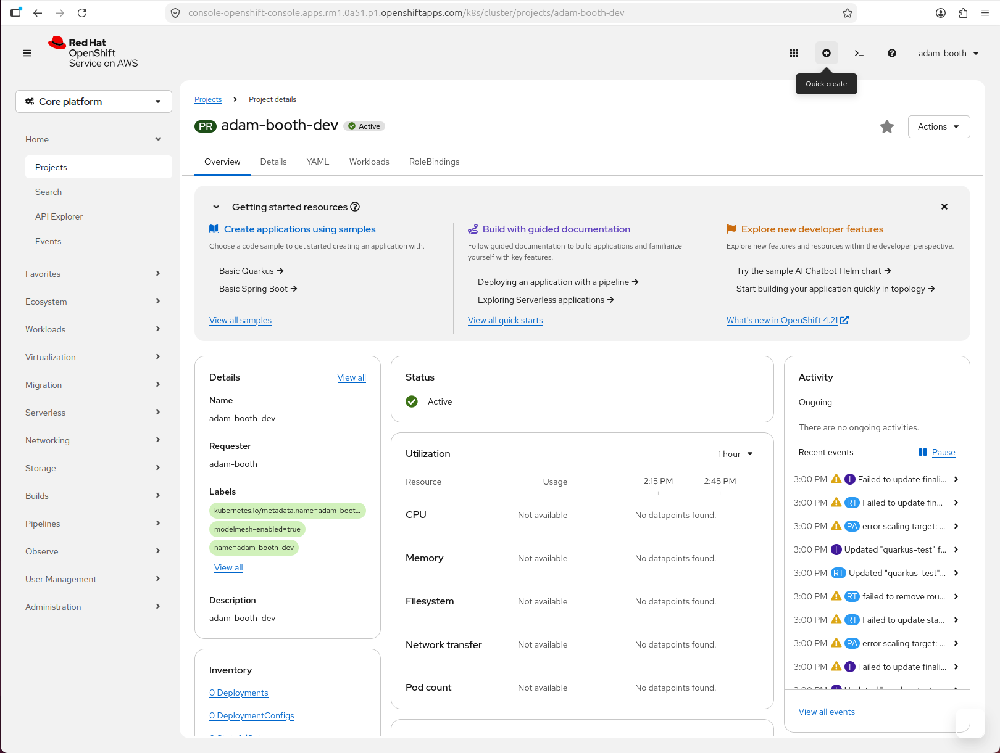

TIP: You can return to this page at any time by navigating to *Home -> Projects* and selecting your project.

=== GitHub Access Token [[github_token]]

link:https://www.youtube.com/watch?v=2SkR8hDCpvA&t=25m47s[Tutorial Video - 25m47s]

To permit OpenShift to access and view your private repositories, you must create a personal access token. This provides a secure method for an application to authenticate itself either over HTTPS calls or through the use of the Git API. We will use a *fine-grained* personal access token, which can be restricted to only your coursework repository and given read-only access. To do this:

1. In GitHub, click your profile picture in the top right corner and select 'Settings'
+
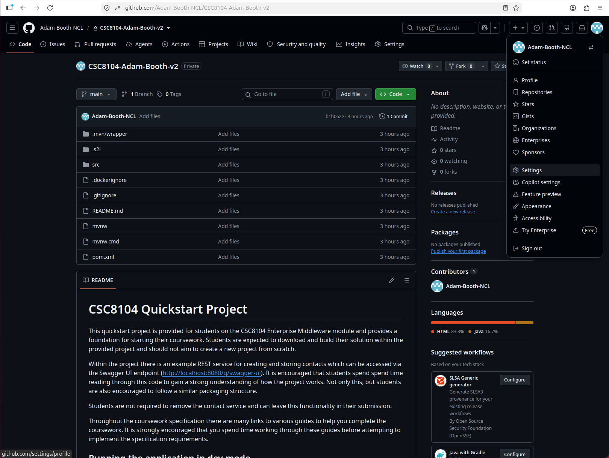
2. Scroll to the bottom of the left-hand menu and select 'Developer settings'
+
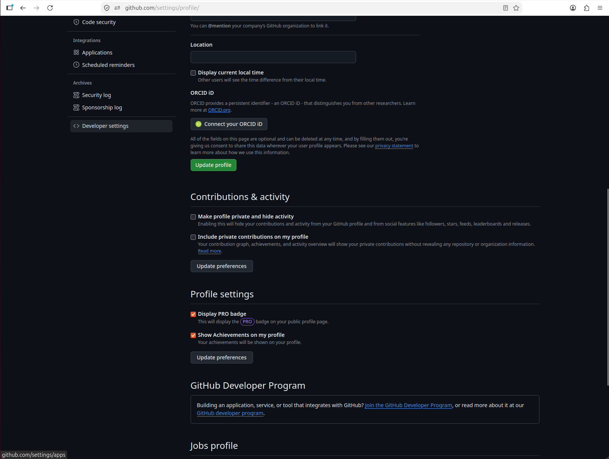
3. Select *Personal access tokens -> Fine-grained tokens*, then press 'Generate new token'
+
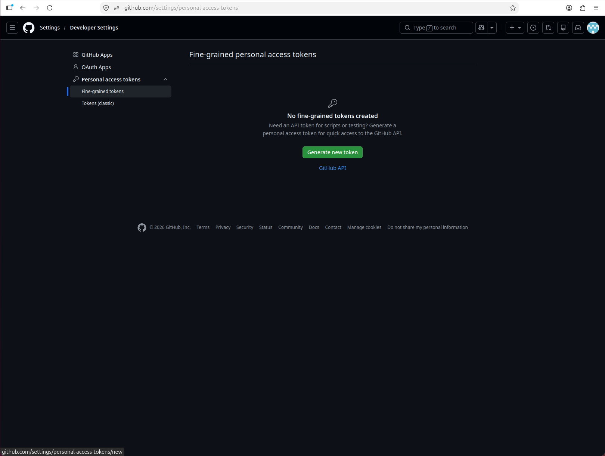
4. Give the token an appropriate name, such as 'OpenShift', and set the token options as follows:
* *Resource owner*: your GitHub account
* *Expiration*: a date after the end of the module. OpenShift uses this token every time it builds your application, so if the token expires you will no longer be able to deploy new versions of your code
* *Repository access*: select 'Only select repositories' and choose your private coursework repository
* *Permissions*: press 'Add permissions' and add *Contents* and *Webhooks*, both with `Read-only` access. *Metadata* is added automatically as `Read-only` and is required
+
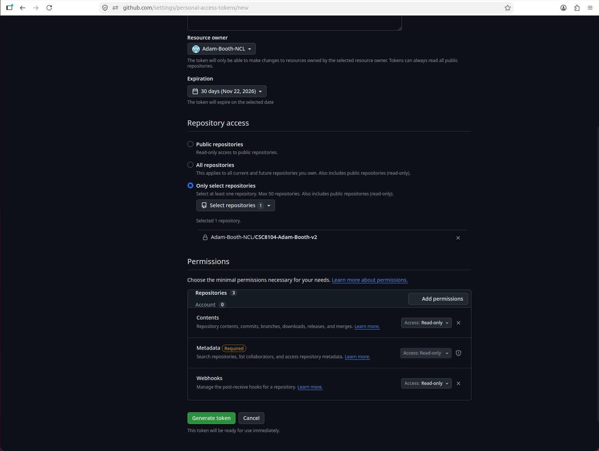
5. Press 'Generate token'

IMPORTANT: Make sure you either copy the token or do not navigate away from this page for now! As GitHub states, you will only have access to the token while on that page

=== Create a New Secret [[openshift_secret]]

link:https://www.youtube.com/watch?v=2SkR8hDCpvA&t=27m00s[Tutorial Video - 27m00s]

We need to create a secret using this GitHub token, which we can then use to permit builds from our source code.

To do this, navigate to the Secrets page shown on the OpenShift web interface. You can find this by scrolling down the project overview page and clicking the 'Secrets' link in the *Inventory* section, or by navigating to *Workloads -> Secrets*.

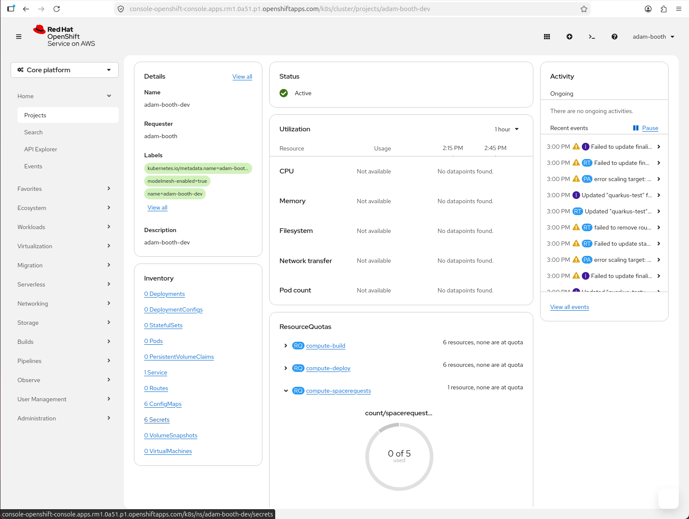

Once on this page, press the 'Create' button in the top right section and select 'Source secret'.

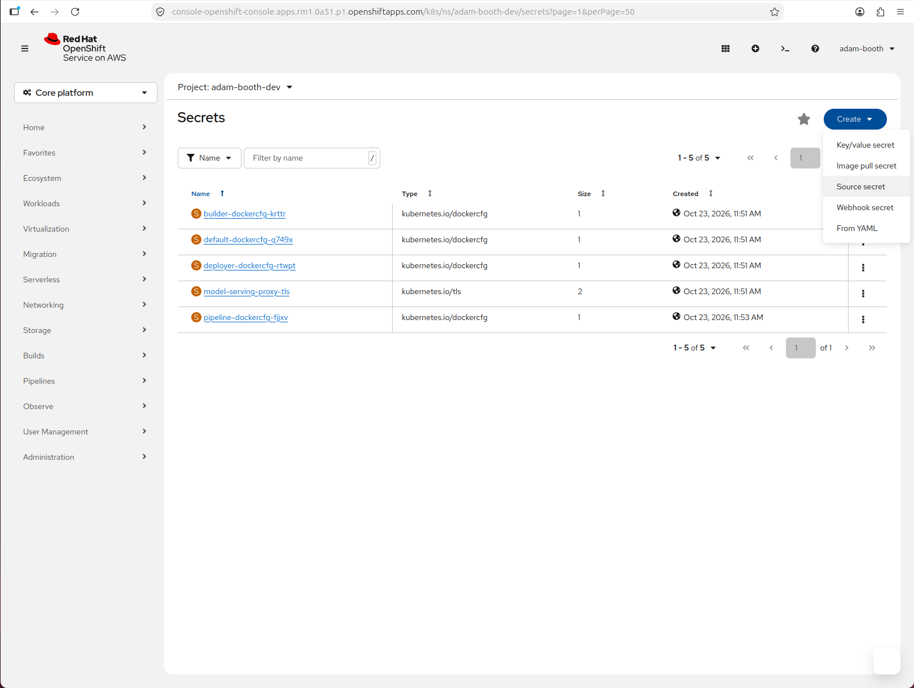

Set the secret name to 'csc8104' and leave the Authentication type as 'Basic authentication'. You may enter your GitHub username into the Username text field, however this is optional when using a fine-grained token. Finally, paste the access token created in the previous step into the 'Password or token' field and click create.

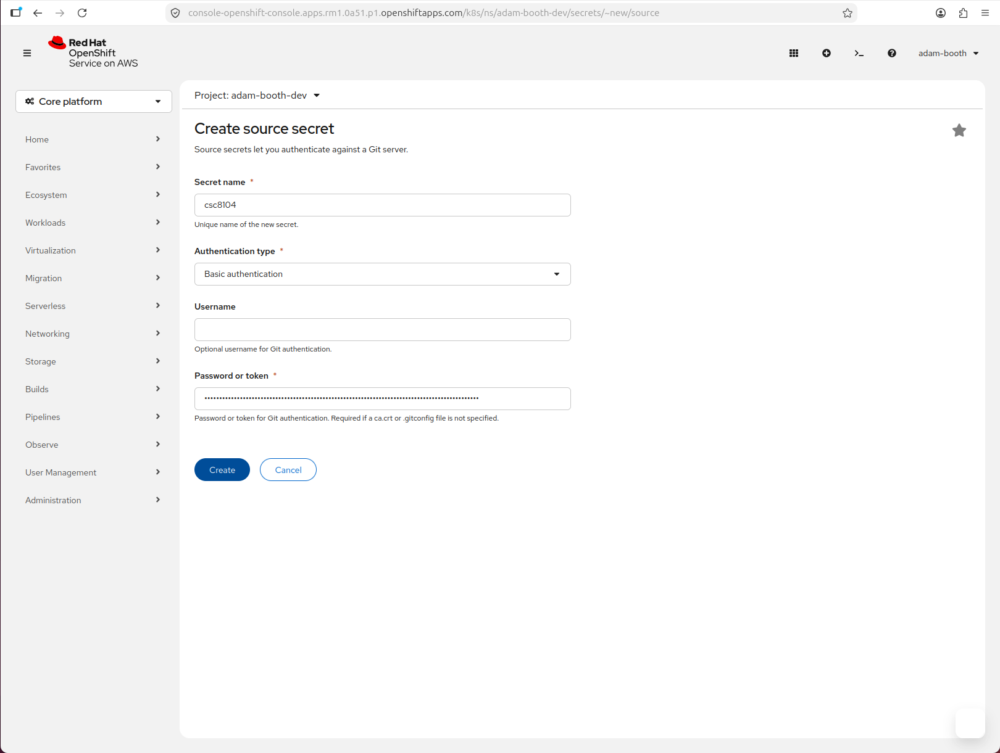

This will create a secret which will be used to fetch, build and deploy your application from your private repository.

== Deploying the Quickstart

link:https://www.youtube.com/watch?v=2SkR8hDCpvA&t=27m54s[Tutorial Video - 27m54s]

The next stage is to deploy the application. To do this, press the 'Quick create' (*+*) button shown at the top of the OpenShift web interface and then select 'Import from Git'.

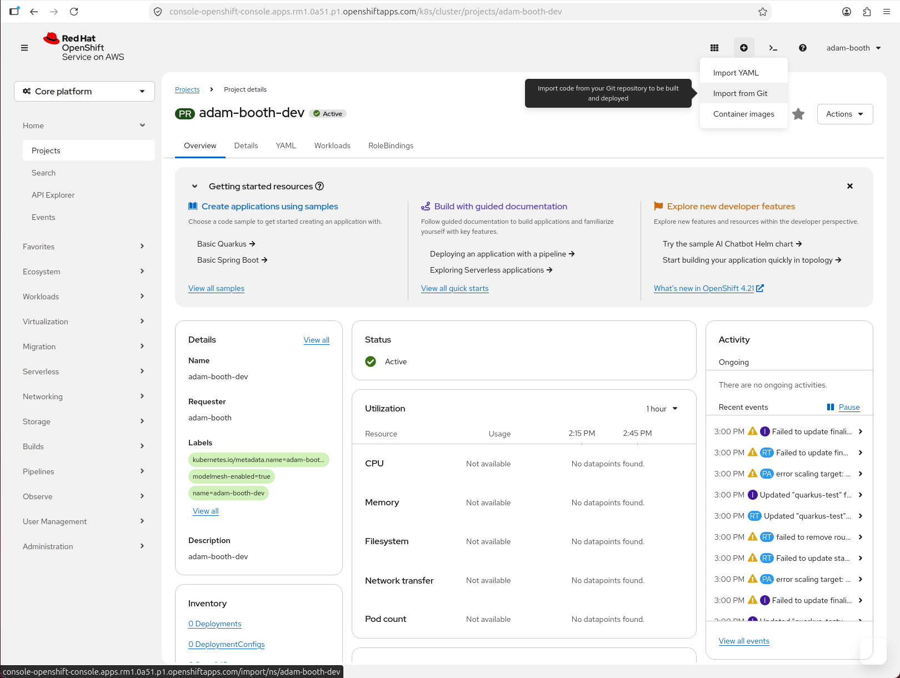

Paste in your private GitHub repository URL and then expand the 'Show advanced Git options'. In the advanced options, press the 'Source Secret' dropdown and select the previously generated `csc8104` secret. This will enable OpenShift to access the repository and determine the build type, and the Git Repo URL will be marked as 'Validated'.

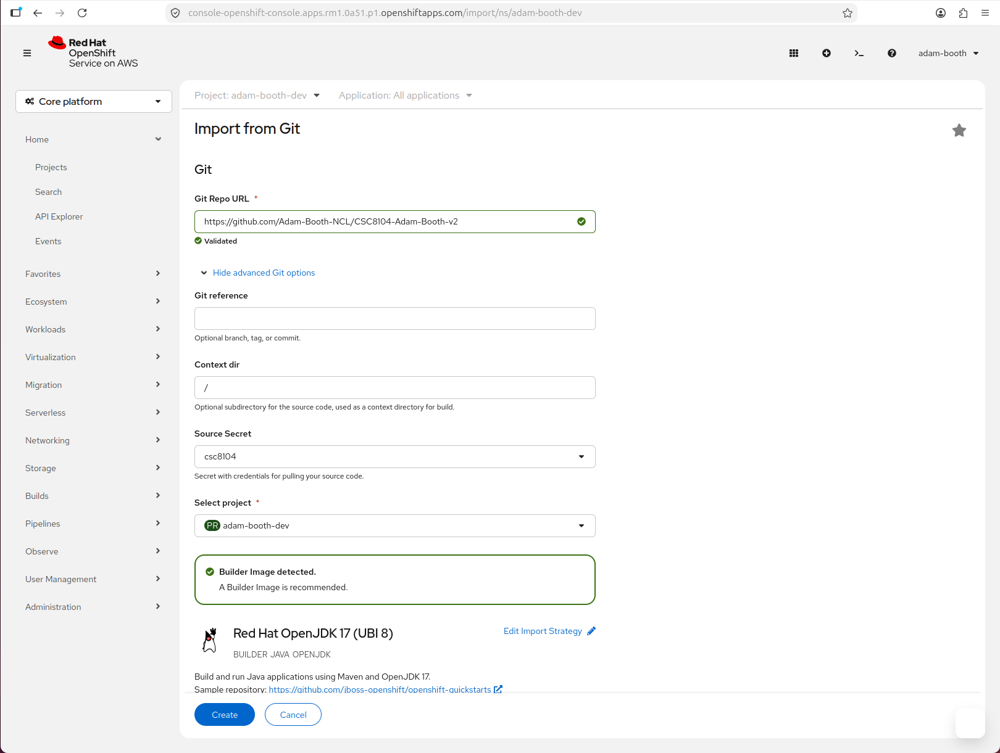

After selecting the source secret, you should now see that OpenShift has detected a builder image (*Red Hat OpenJDK 17*) and pre-configured various route and deployment options. Leave all these options as provided, ensuring that the resource type is set to *Serverless Deployment*, and press create. This will generate a new build configuration, start building your application using S2I, and create a serverless service on the platform accessible by the route provided.

You will then be taken to the *Topology* view, where you can see your new serverless service (*KSVC*). Selecting it shows the current build, the revisions of your service, and the route for your application.

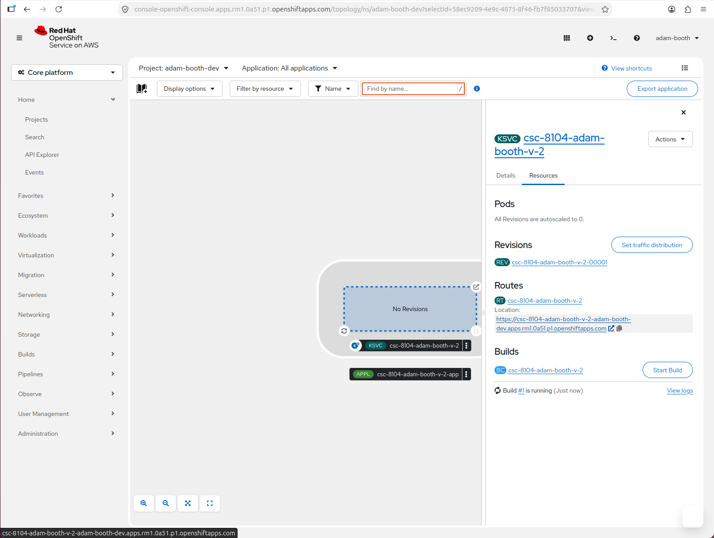

TIP: The first build can take several minutes. While it is running the service will show 'No Revisions'. You can see the progress of the build by clicking 'View logs' next to the running build.

WARNING: You have been given access to create multiple pods to allow for rolling deployment. Please *DO NOT* scale your system to use multiple pods to run your application.

To access the public URL given for your application, copy the Location value shown under *Routes* in the Topology view. You can also find this by navigating to *Serverless -> Serving* and copying the URL for your service.

Once the build has completed, opening the route in your browser should show the Quarkus welcome page.

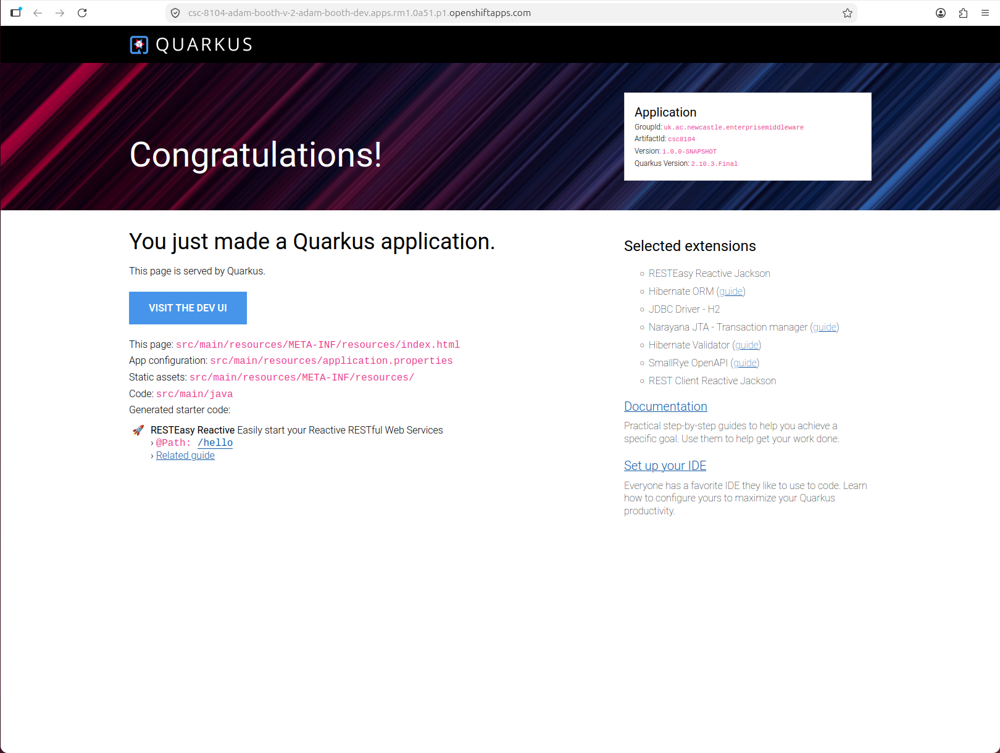

To check that your API is working, append `/q/swagger-ui` to the end of the route URL. This will show the Swagger UI for your service, from which you can test each of your endpoints.

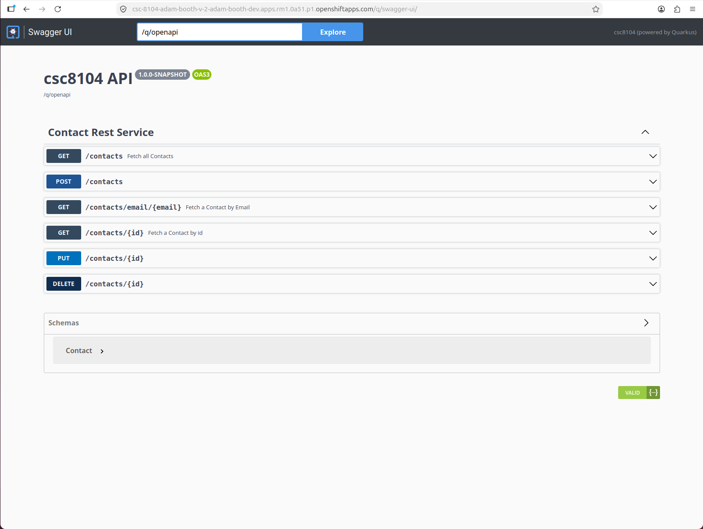

IMPORTANT: *Once you have completed this stage and have a link to the route for your service, please email Adam Booth (adam.booth@newcastle.ac.uk) as soon as possible! He will append this to the document https://github.com/NewcastleComputingScience/csc8104-assignment[here], where you will be able to find links to your colleagues services for Part III*
