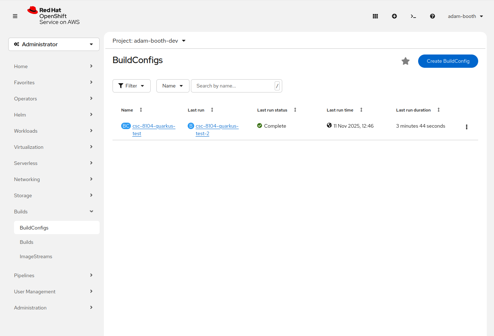
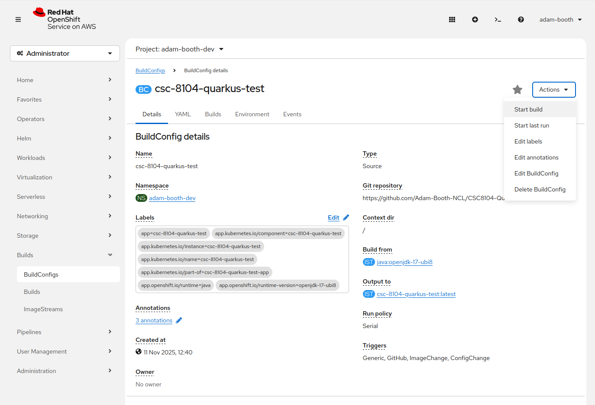
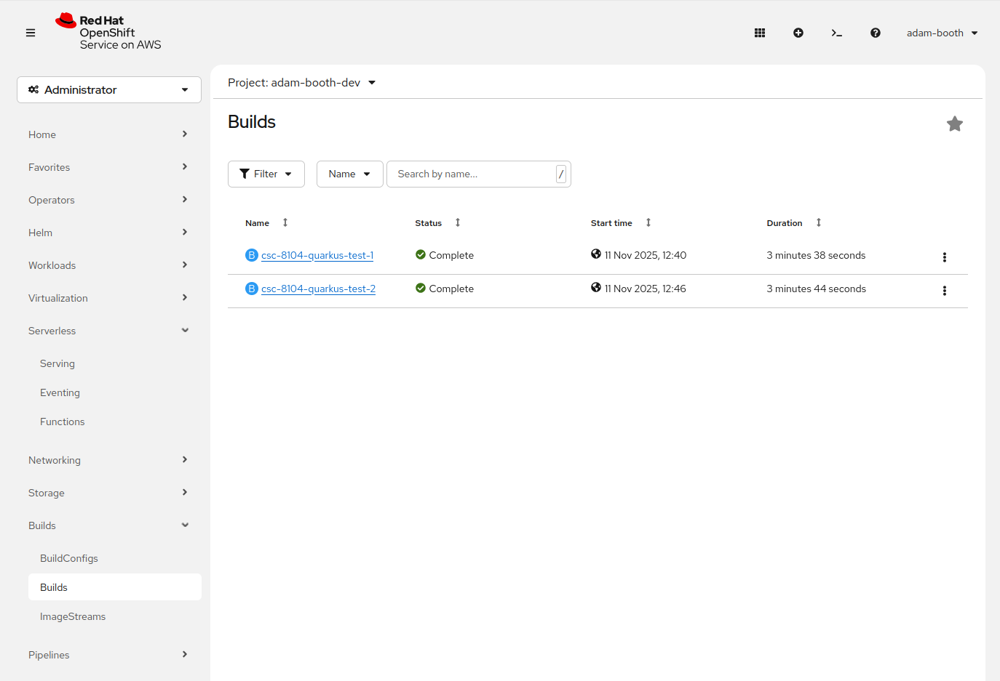
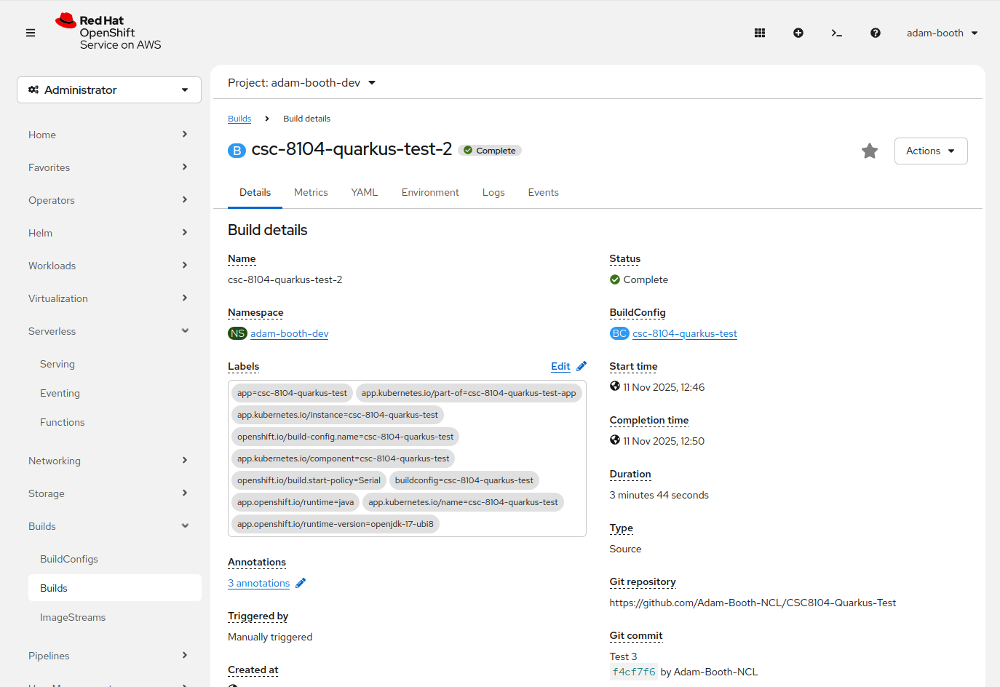
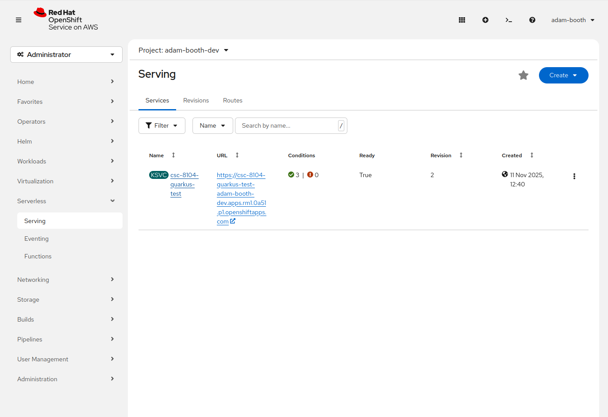
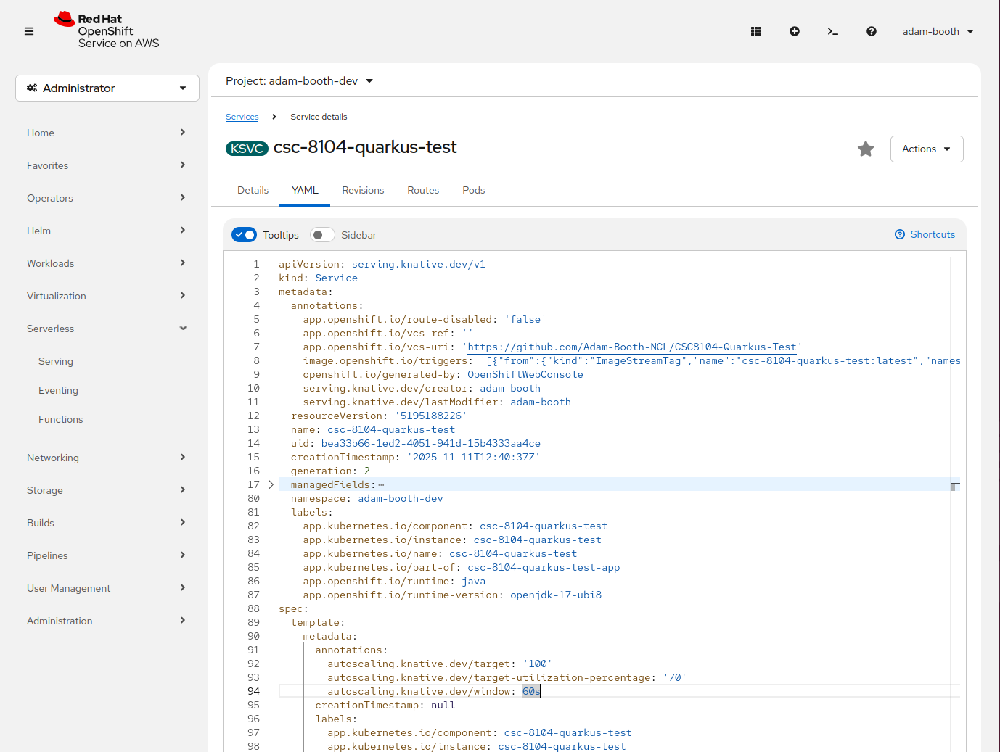
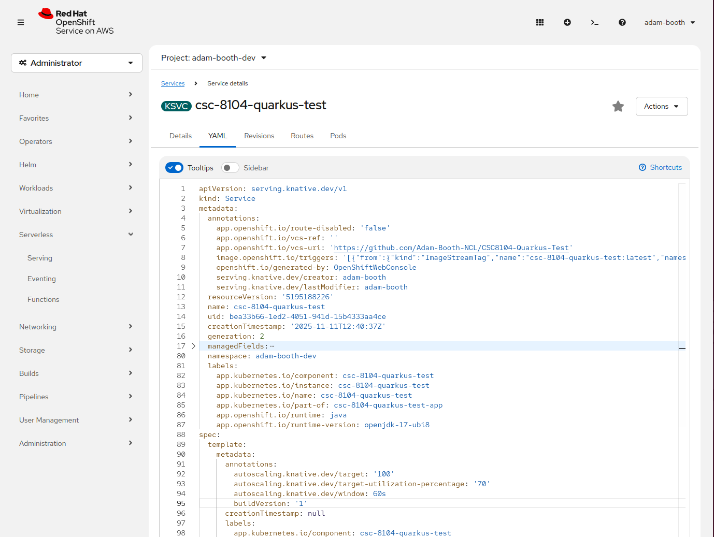
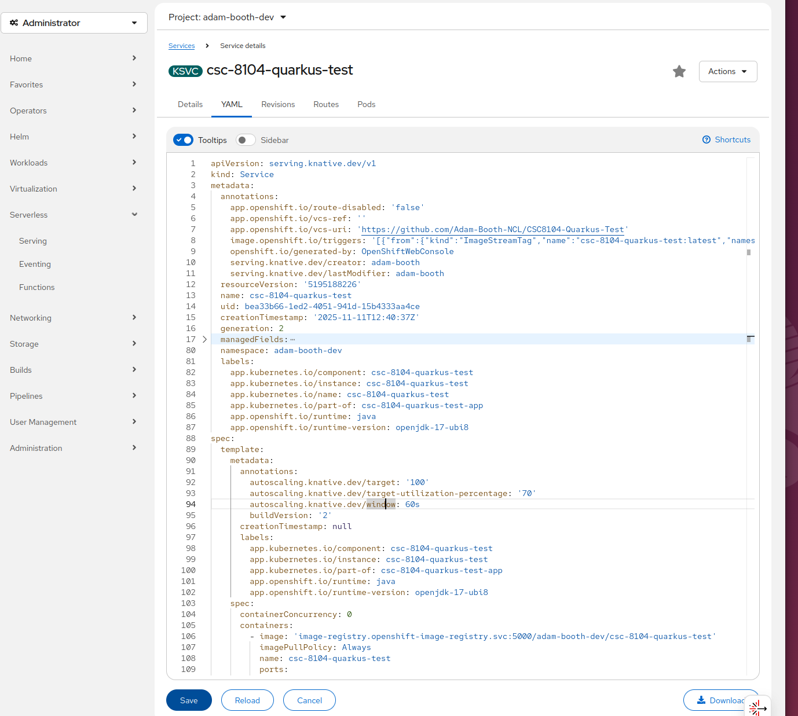

## Build a new image and trigger a Serverless redeploy

OpenShift Serverless (Knative) doesn’t automatically redeploy when an image is rebuilt via S2I. Knative creates a new revision only when the Service spec changes. To force a redeploy after building a new image, add or update a small annotation (for example `buildVersion`) under the Service’s template metadata.

### 1) Build the new image
1. In the OpenShift console, choose Builds → BuildConfigs.  
    
2. Select your BuildConfig, then open Actions → Start build to create a new image.  
    
3. After the build starts, go to Builds (left menu) to view build history.  
    
4. Open the latest build and check the Git commit used (bottom right) in the build details to confirm you built the correct revision.  
    

### 2) Force a Serverless (Knative) redeploy
1. In the console, open Serverless → Serving.  
    
2. Select the Service you want to update and open the YAML tab. Under `spec.template.metadata.annotations` add a `buildVersion` annotation, or increment its value if it already exists. See the images below for reference (lines 94 and 95).  
      
    
    - Use a simple numeric string and bump it each time you want to trigger a redeploy (e.g., `"1"`, `"2"`, `"3"`).
3. Save the YAML. Knative will detect the spec change and create a new revision that pulls the updated image.  
    

### Notes and troubleshooting
- If deployment doesn’t happen within a minute or two, check the Service’s revision history and the pod logs for image pull or permission errors.
- This annotation trick is a simple, explicit way to force a new revision when the image alone does not trigger Knative to redeploy.
