= Enterprise Software and Services Coursework - Tutorial

This tutorial guides you through the necessary preparation required to begin your Enterprise Software and Services coursework.
It is very important that you have completed this and are comfortable with the example, before beginning the coursework.

== Create Accounts

_This section applies to **all students**_

To complete this coursework you will need accounts with GitHub and OpenShift.

=== GitHub
GitHub offers the Git version control system as a service.
You will use it to host your code and to make it available to the demonstrators.
GitHub is very popular in the open-source community and works best when you make your code available to others to view, clone and contribute towards.
However, given the confidential nature of your coursework, you will need to use a private repository only accessible by yourself and the demonstrators.

A private repository will be created for you which you will be given access to once the lead demonstrator has been provided with your GitHub username (see steps below).

If you do not already have an account you will need to:

1. Go to: https://github.com/
2. Fill in your details and select "Sign up for GitHub."
3. Obtain a private repository.

TIP: GitHub is a very popular service, and you are quite likely to use it in your professional career; especially if you work with open source software in some capacity.

=== OpenShift [[openshift]]
OpenShift is a Platform as a Service (PaaS) Cloud offered by Red Hat.
It can host many types of applications, but for this coursework you will be using it to host your Quarkus REST service.

You will be using the OpenShift Developer Sandbox to develop and test your applications. The developer sandbox automatically deallocates your application after 8 hours. This restriction will be removed from your account towards the end of the module.

To create a Red Hat account and access the developer sandbox environment:

1. Navigate to: https://developers.redhat.com/developer-sandbox/get-started
2. Click the Launch your Developer Sandbox for Red Hat OpenShift button
3. Click Register for a Red Hat account
4. Complete all setup steps, including confirming your email address
5. Send an email to Adam Booth (adam.booth@newcastle.ac.uk) with your *student number*, *GitHub Username*, and *Red Hat Login ID*

At this stage you will be waiting for provisioning to continue. Once we have setup a project and provided you with access you will receive an email confirmation.

NOTE: Please continue with the steps below, up to and including <<repository_setup>>. You should then be able to run the contacts-swagger quickstart locally, and have your code available within your Git repository.

*Once you have completed the steps below, you will now be able to proceed to setup a new build of the quickstart on OpenShift, by following the <<openshift_deploy>> section.*

== Environment Setup

_This section of the tutorial only applies to students working on *their own* machines, not those provided by the university!_

This coursework depends upon several software packages / development tools. You must ensure you follow the instructions to install the following:

* link:https://jdk.java.net/java-se-ri/17[Java 17]
* link:https://git-scm.com/[Git]
* link:https://maven.apache.org/[Maven]

== Run Example

Now you will run a simple example.
This example provides you with a starting point that you will build on when you come to doing the coursework.
Therefore, it is very important that you get this working and become familiar with the code.

=== Obtain the Contacts-Swagger Quickstart [[obtain_quickstart]]

_This section applies to **all students**_

1. Visit the NewcastleComputingScience/CSC8104-Quarkus github repo release page https://github.com/NewcastleComputingScience/CSC8104-Quarkus/releases/tag/v1.0.4[here].
2. Click on the *Source code (zip)* link to obtain the contacts-swagger quickstart
3. Unzip the download to somewhere on your computer. Be aware this may take some time as there are many files and you are likely writing to your (networked) `H` drive.
4. Open a Command Prompt, and go to the root directory in the contacts quickstart you just unzipped.

NOTE: You can find a Command Prompt from the Start menu by searching, or start PowerShell using `win+x i`.

=== Run the Quickstart

_This section applies to **all students**_

Start the service by executing the command provided on the quickstart page link:https://github.com/NewcastleComputingScience/CSC8104-Quarkus[here].

== Working with Git [[repository_setup]]

_This section applies to **all students**_

You will be using Git in the coursework for regular checkpoint and backup of your code to GitHub.
You will also use your GitHub repository as the basis to deploy new versions of your application to OpenShift.
This section will show you how to create a copy of the 'contacts-swagger' example, ready for you to extend in the coursework, and also how to push the code to GitHub and OpenShift.

* Clone your original private repository from GitHub to a location where you would like to perform your work (correct the url to that of your private repository).

    git clone https://github.com/NCL-CloudComputing/csc8104-your-repo.git

* Copy the contents of the contacts-swagger quickstart into your private repository, which you downloaded in step <<obtain_quickstart>>.
* Now you need to push this code to your git repository on GitHub.

    git add .
    git commit -m "Starter project added to repository"
    git push origin main

* You can use a similar method to add new files or changes, commit these changes, and push your commits to the remote repository.

WARNING: There are two directories, .mvn and .s2i, which are required when deploying to OpenShift. Your operating system may hide these by default and you should take care when copying files to ensure that these directories are included. If they are not included, your deployment will fail, resulting in a 'CrashLoopBackOff' error when using OpenShift.

TIP: If you are new to Git, you should read Pro Git. Chapters 1-3 should cover all the functionality required for this coursework.  Available at: http://git-scm.com/book

*Now you have the quickstart code within your private GitHub repository, you can continue to the <<openshift_deploy>> section to setup your build.*

== Deploying to OpenShift [[openshift_deploy]]

_This section applies to **all students**_

OpenShift 4 is RedHat's Platform as a Service (PaaS) offering. The system wraps around Kubernetes, and so some of the commands and terminology used refers to the underlying infrastructure. The system consists of deploying applications from images where we can easily recreate and scale up and down services. A service can consist of many different 'pods', which are instances of our application to permit distribution of load. For more information see link:https://kubernetes.io/docs/concepts/overview/what-is-kubernetes/[What is Kubernetes?]. For your coursework, you will have a single service running which will contain your API.

In this module your application is deployed as an *OpenShift Serverless* service (built on link:https://knative.dev/docs/serving/[Knative Serving]). OpenShift uses Source-to-Image (S2I) to build your Quarkus application directly from your GitHub repository into an image, and then runs that image as a Knative Service (shown as *KSVC* in the web console). A serverless service automatically scales down to zero pods when it is not being used, and starts a new pod again when it next receives a request.

Make sure that you fully complete the instructions listed here, up to the point where you must email Adam Booth (adam.booth@newcastle.ac.uk) with your Route information!

Once you have completed the instructions here you should expect your OpenShift resources to be similar to the following image.

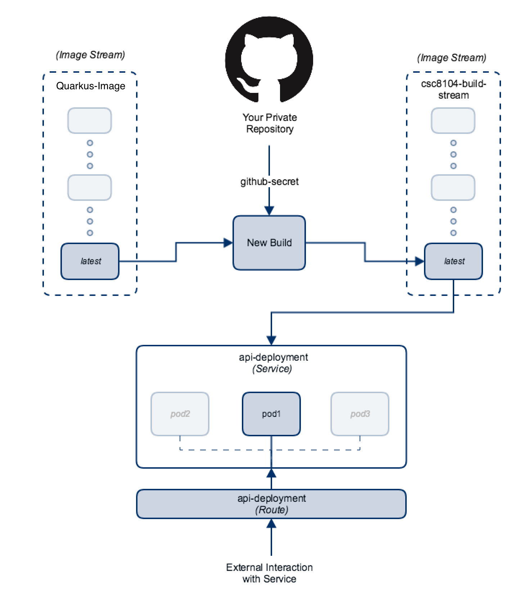

NOTE: The names shown in the image above (and in the screenshots throughout this section) will differ from yours. OpenShift names your build, image stream, service and route after your GitHub repository.

=== Initial Setup

==== Accessing the OpenShift Console

At this stage you should have the accounts setup and the required applications installed to deploy your application to OpenShift. If you are not currently at this stage please refer to the <<openshift>> and <<repository_setup>> sections above.

Once your OpenShift account has been successfully provisioned (as mentioned above), you will have the option to access the web console. To do this, log in to the link:https://sandbox.redhat.com[Red Hat Developer Sandbox] and press the 'Try it' button on the *OpenShift* card.

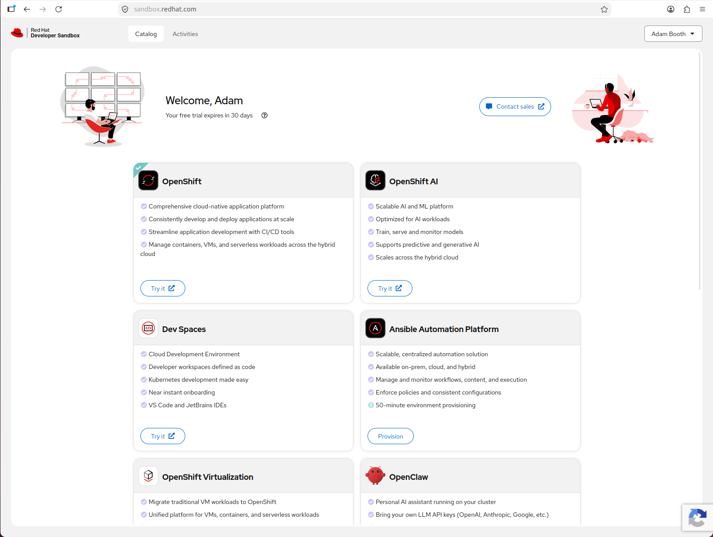

This will open the OpenShift web console on your project, which will be named after your Red Hat username followed by `-dev`. The project overview page shows the details of your project, along with an inventory of the resources it contains.

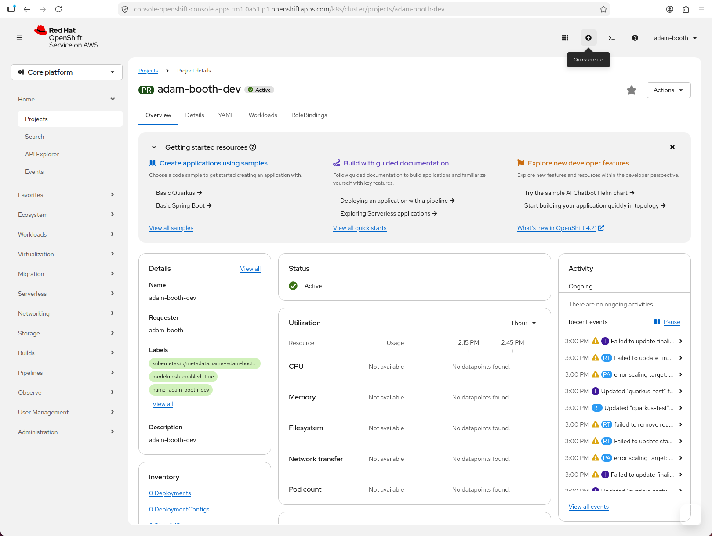

TIP: You can return to this page at any time by navigating to *Home -> Projects* and selecting your project.

==== GitHub Access Token [[github_token]]

To permit OpenShift to access and view your private repositories, you must create a personal access token. This provides a secure method for an application to authenticate itself either over HTTPS calls or through the use of the Git API. We will use a *fine-grained* personal access token, which can be restricted to only your coursework repository and given read-only access. To do this:

. In GitHub, click your profile picture in the top right corner and select 'Settings'
+
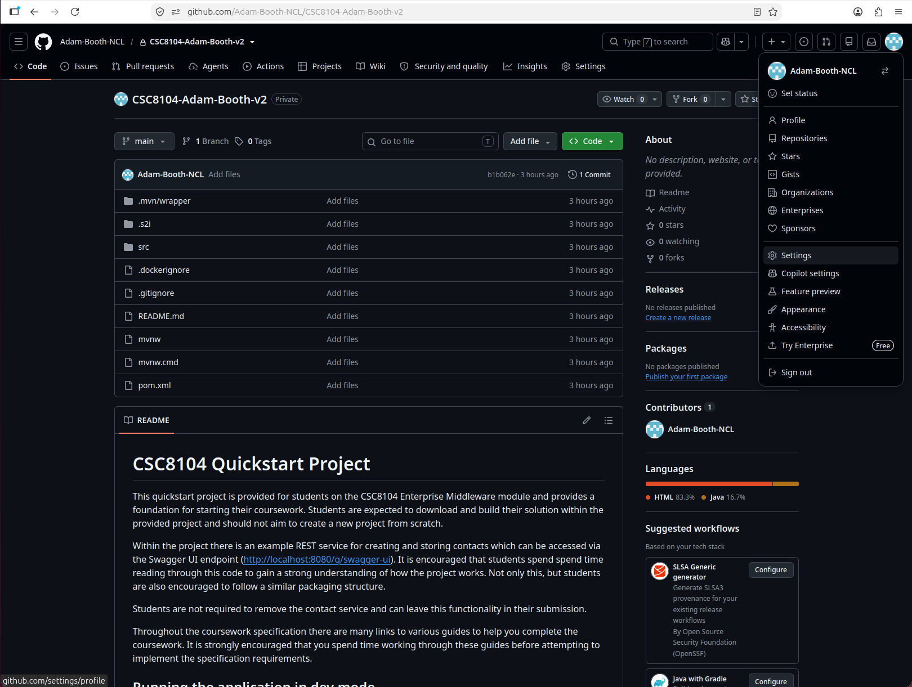

. Scroll to the bottom of the left-hand menu and select 'Developer settings'
+
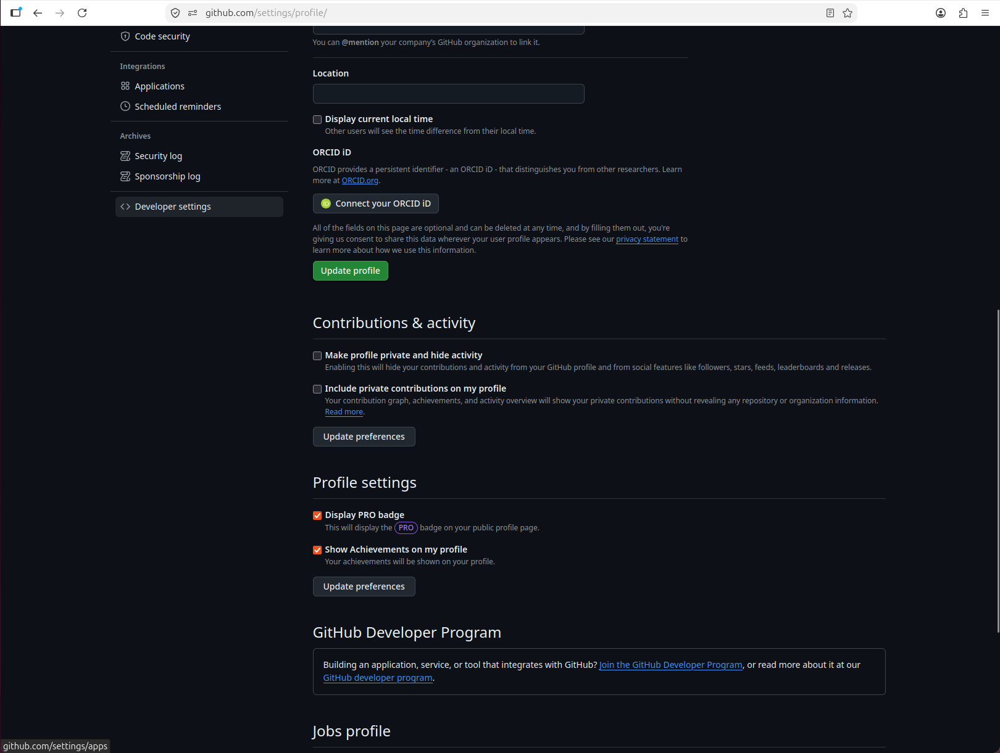

. Select *Personal access tokens -> Fine-grained tokens*, then press 'Generate new token'
+
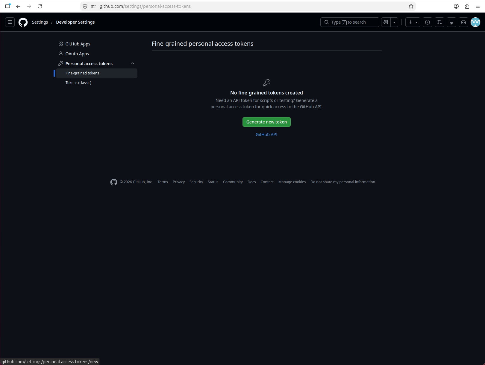

. Give the token an appropriate name, such as 'OpenShift', and set the token options as follows:
+
--
* *Resource owner*: your GitHub account
* *Expiration*: a date after the end of the module. OpenShift uses this token every time it builds your application, so if the token expires you will no longer be able to deploy new versions of your code
* *Repository access*: select 'Only select repositories' and choose your private coursework repository
* *Permissions*: press 'Add permissions' and add *Contents* and *Webhooks*, both with `Read-only` access. *Metadata* is added automatically as `Read-only` and is required

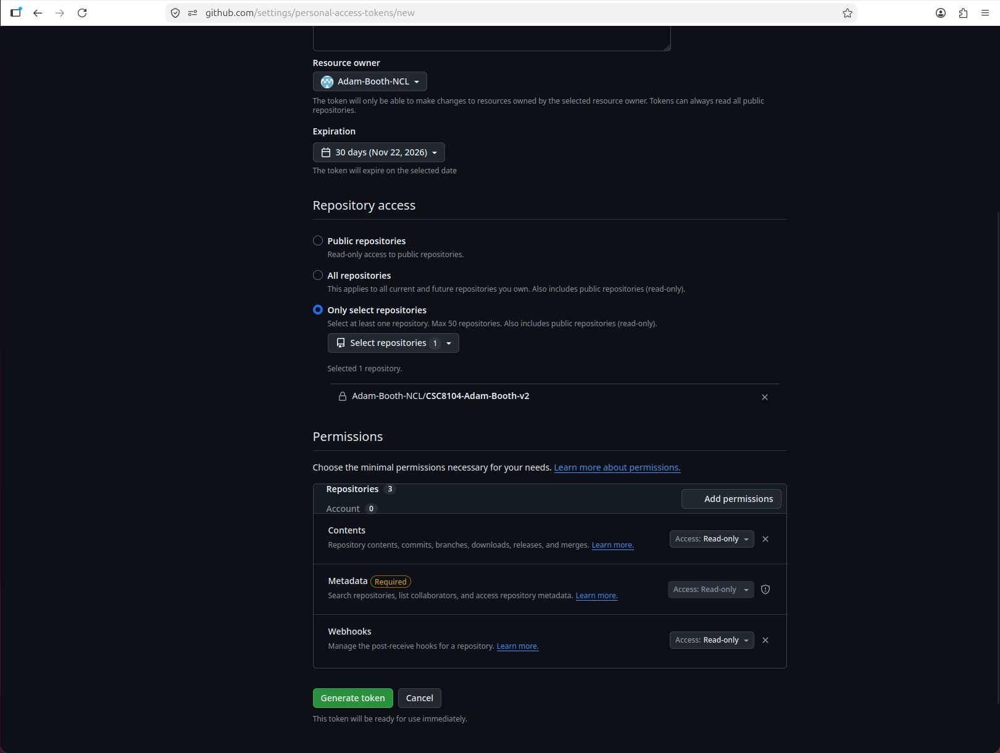
--

. Press 'Generate token'

IMPORTANT: Make sure you either copy the token or do not navigate away from this page for now! As GitHub states, you will only have access to the token while on that page

==== Create a New Secret [[openshift_secret]]

We need to create a secret using this GitHub token, which we can then use to permit builds from our source code.

To do this, navigate to the Secrets page shown on the OpenShift web interface. You can find this by scrolling down the project overview page and clicking the 'Secrets' link in the *Inventory* section, or by navigating to *Workloads -> Secrets*.

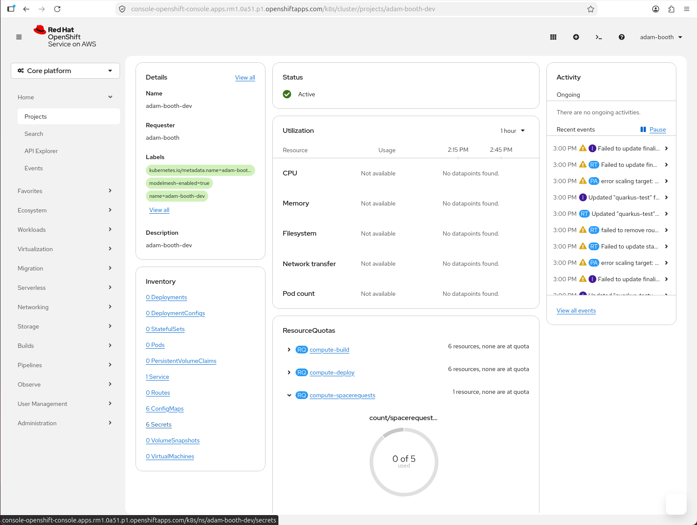

Once on this page, press the 'Create' button in the top right section and select 'Source secret'.

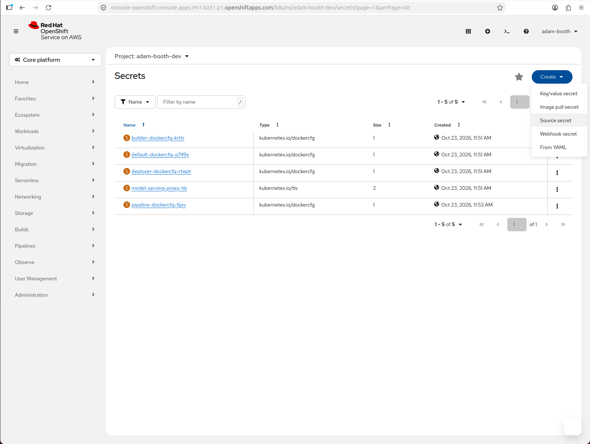

Set the secret name to 'csc8104' and leave the Authentication type as 'Basic authentication'. You may enter your GitHub username into the Username text field, however this is optional when using a fine-grained token. Finally, paste the access token created in the previous step into the 'Password or token' field and click create.

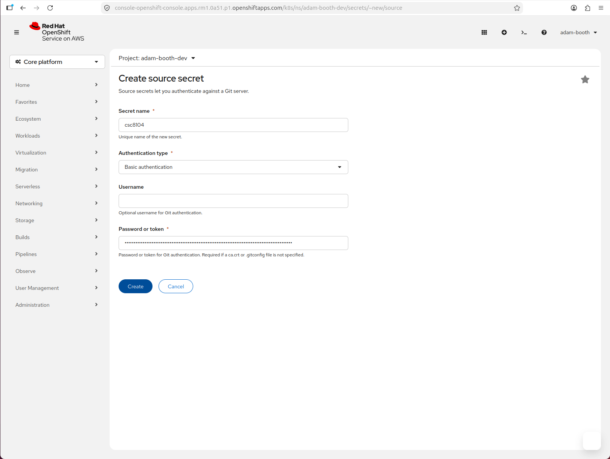

This will create a secret which will be used to fetch, build and deploy your application from your private repository.

=== Deploying the Quickstart

The next stage is to deploy the application. To do this, press the 'Quick create' (*+*) button shown at the top of the OpenShift web interface and then select 'Import from Git'.

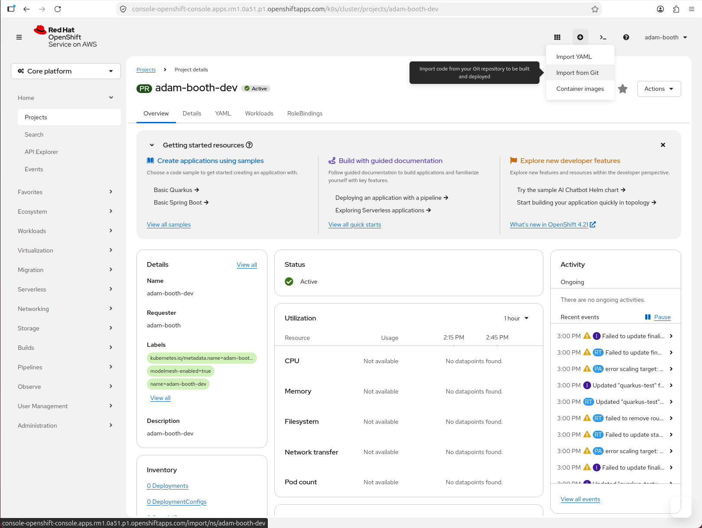

Paste in your private GitHub repository URL and then expand the 'Show advanced Git options'. In the advanced options, press the 'Source Secret' dropdown and select the previously generated `csc8104` secret. This will enable OpenShift to access the repository and determine the build type, and the Git Repo URL will be marked as 'Validated'.

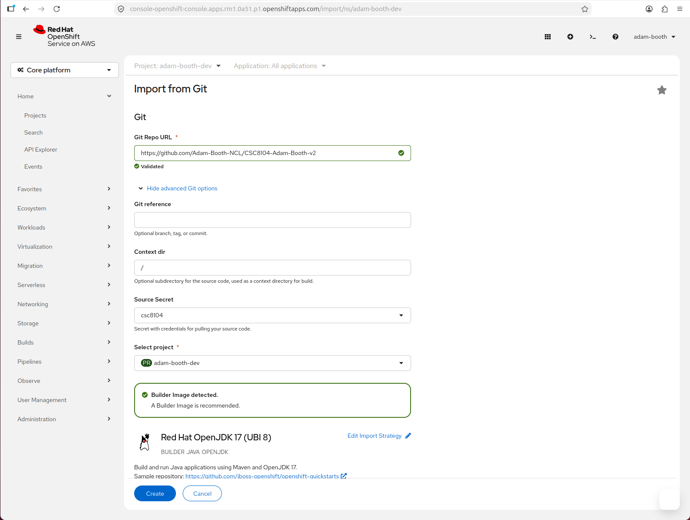

After selecting the source secret, you should now see that OpenShift has detected a builder image (*Red Hat OpenJDK 17*) and pre-configured various route and deployment options. Leave all these options as provided, ensuring that the resource type is set to *Serverless Deployment*, and press create. This will generate a new build configuration, start building your application using S2I, and create a serverless service on the platform accessible by the route provided.

You will then be taken to the *Topology* view, where you can see your new serverless service (*KSVC*). Selecting it shows the current build, the revisions of your service, and the route for your application.

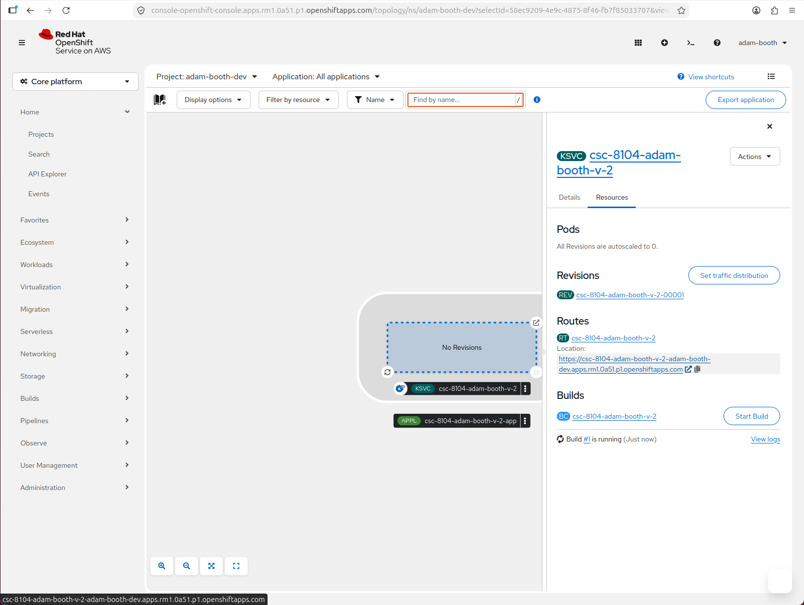

TIP: The first build can take several minutes. While it is running the service will show 'No Revisions'. You can see the progress of the build by clicking 'View logs' next to the running build.

WARNING: You have been given access to create multiple pods to allow for rolling deployment. Please *DO NOT* scale your system to use multiple pods to run your application.

To access the public URL given for your application, copy the Location value shown under *Routes* in the Topology view. You can also find this by navigating to *Serverless -> Serving* and copying the URL for your service.

Once the build has completed, opening the route in your browser should show the Quarkus welcome page.

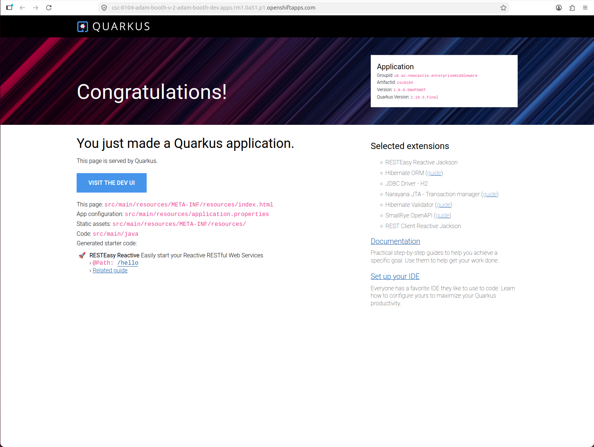

To check that your API is working, append `/q/swagger-ui` to the end of the route URL. This will show the Swagger UI for your service, from which you can test each of your endpoints.

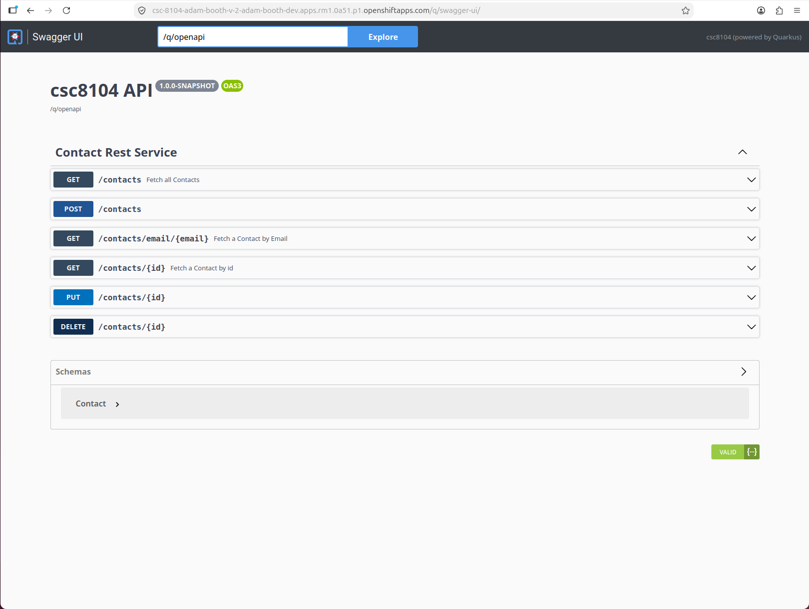

IMPORTANT: *Once you have completed this stage and have a link to the route for your service, please email Adam Booth (adam.booth@newcastle.ac.uk) as soon as possible! He will append this to the document https://github.com/NewcastleComputingScience/csc8104-assignment[here], where you will be able to find links to your colleagues services for Part III*

== Eclipse Setup

_This section applies to **all students**_

If you are on a University machine and wish to use Eclipse to edit the contacts-swagger example (and your coursework), you should use the version of Eclipse neon provided on your uni machine.

If you are on your own machine we recommend you visit the Eclipse https://www.eclipse.org/downloads/eclipse-packages/[downloads page] and select the "Eclipse IDE for Java EE Developers" which comes with Maven support.

Regardless, once in Eclipse you must add the contacts-swagger example to your workspace using the following steps:

. *Import the maven project into eclipse*.
  .. Within a new workspace, click 'File' -> 'Import...'
  .. Select 'Maven' -> 'Existing Maven Projects'
  .. Click on 'Browse' and select the contacts-swagger quickstart folder.
  .. Click 'Finish'

TIP: You may use other IDEs or editors if you like, but we may not be able to provide support.

IMPORTANT: When you first import the project, maven will download all of the project dependencies to an `.m2` repository folder on your `H` drive. This may take a *very* long time.

== Viewing your datasource

During development of your application, you may find it very useful to be able to inspect the contents of your database. To do this, run the ‘DBeaver’ application and create a new database connection by clicking the plug icon shown in the image below.

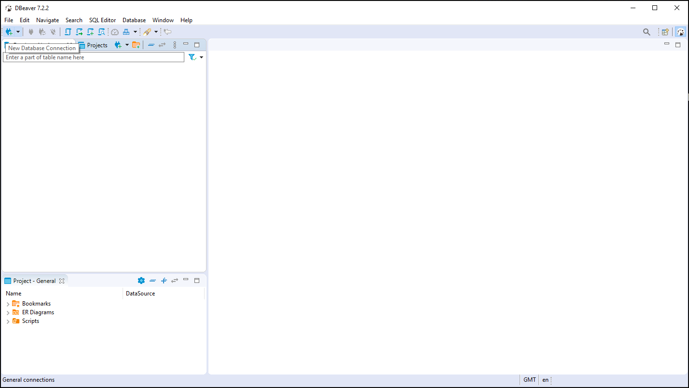

Then with the SQL tab selected, search for H2 and select ‘H2 Server’.

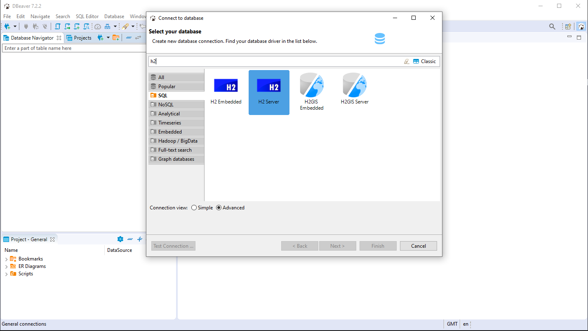

On the next page, click Edit Driver Settings and paste the following connection string into the URL Template field `jdbc:h2:tcp://localhost/mem:quarkus;DB_CLOSE_ON_EXIT=FALSE` and click OK and Finish.

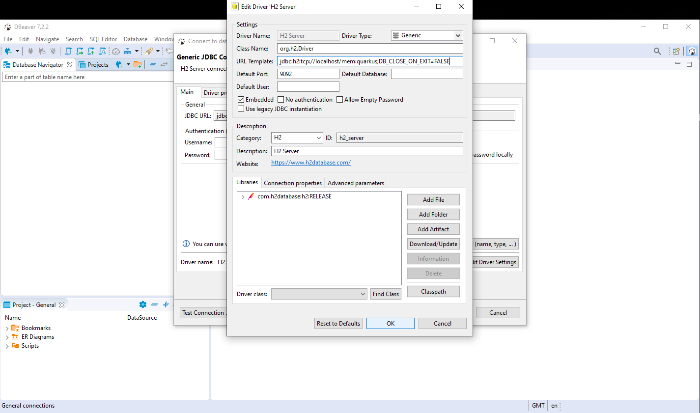

Once the connection is created, you can expand the New Connection. To view the created tables and stored data, expand the PUBLIC section, expand Tables and then double-click on the table names to open the view.

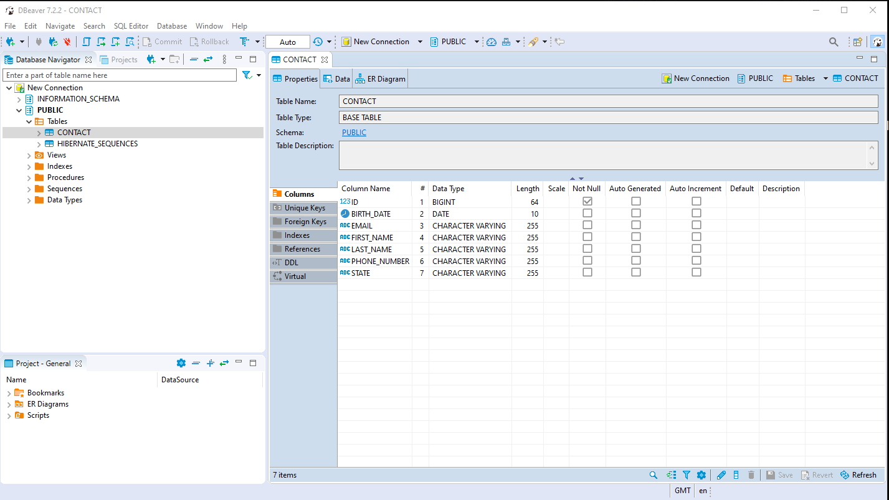

== Testing your API

Besides the REST Assured tests run through maven, you will occasionally want to test your API in a more manual fashion, in order to clearly see what information is being sent and received.

It is partly for this purpose that the Contacts-Swagger quickstart uses the link:http://swagger.io[Swagger] tool to generate API documentation.

Not only does Swagger use link:https://github.com/swagger-api/swagger-core/wiki/Annotations-1.5.X[@Annotations] to automatically generate attractive documentation for API endpoints, but this documentation is interactive.
This allows you to run each supported HTTP operation from the documentation webpage with sample input and see the response JSON.
An example of swagger documentation can be found link:http://petstore.swagger.io/[here].

Another common method of manual testing of APIs is sending http requests from the command line, using a tool called link:http://curl.haxx.se/[cURL].

To give you an example of how you might use cURL to see what your API is doing, once the QuickStart is running (locally) you could execute the following commands (in a command prompt):

* to see a list of all contacts returned, formatted as JSON and accompanied by all HTTP headers.

    curl -v http://localhost:8080/contacts/

* to create a new contact.

// ** Unix/Command Prompt:

    curl -X POST --header "Content-Type: application/json" --header "Accept: application/json" -d "{\"firstName\": \"Alice\",\"lastName\": \"Bob\",
\"email\": \"alice@bob.com\",\"phoneNumber\": \"(231) 111-1111\",\"birthDate\": \"1982-10-26\"}" "http://localhost:8080/contacts"

// ** PowerShell:

//     Invoke-RestMethod -Method POST -Headers @{'Content-Type' = 'application/json'; 'Accept' = 'application/json'} -Body "{
//       `"firstName`": `"Alice`",
//       `"lastName`": `"Bob`",
//       `"email`": `"alice@bob.com`",
//       `"phoneNumber`": `"(231) 111-1111`",
//       `"birthDate`": `"1982-10-26`"
//     }" "http://localhost:8080/contacts"

The *-v* switch instructs curl to display all possible information, whilst the *-X* switch allows you to specify the HTTP method to be used and *-d* the data to be sent.

TIP: If you would like to learn more about how to use cURL, you can refer to the link:http://curl.haxx.se/docs/manpage.html[official documentation].

== Understanding the Contacts Quickstart with GitHub Copilot

=== Introduction
link:Understanding_the_Contacts_Quickstart.md[Understanding the Contacts Quickstart]

This tutorial builds on the existing Contacts Quickstart and helps you understand how the Quarkus application works using GitHub Copilot.

You will explore the application structure, HTTP requests, database operations and error handling while learning to question and verify Copilot's explanations.

*Estimated time:* 60–90 minutes.

link:Understanding_the_Contacts_Quickstart.md[Understanding the Contacts Quickstart]

IMPORTANT: Complete the existing Contacts Quickstart before starting this tutorial, and finish this tutorial before beginning your coursework.

=== What you will do

* Explore the application code and predict its behaviour.
* Use GitHub Copilot to explain unfamiliar concepts.
* Check Copilot's responses against the code and supplied evidence.
* Record your findings in your own words.

Some exercises use a separate evidence pack containing sanitised logs and code extracts.

link:Student_evidence_pack.md[Student Evidence Pack]

Remember: Copilot is a learning assistant, not a replacement for your own understanding.
